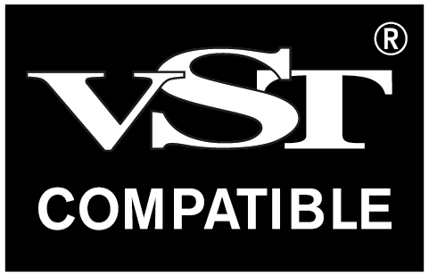

# Simple Spectrum

DAW 向けのスペクトラム表示のオーディオプラグインです。入力の音の周波数ごとの大きさを、20 Hz から 20 kHz の対数の横軸に、なめらかな曲線で表示します。音は変えずにそのまま出力します。Windows x64 と Linux x86_64 向けに、VST® 3 と CLAP の形式で配布します。

A spectrum analyzer for DAWs. It shows the level of the input at each frequency from 20 Hz to 20 kHz on a logarithmic axis, and passes the audio through unchanged. VST® 3 and CLAP formats for Windows x64 and Linux x86_64.

音のプラグイン倉庫くんの[掲載ページ](https://audio-soko-kun.allegromoltov.jp/plugins/allegromoltov/simple-spectrum-audio)から、検査を通った版を入手できます。 / Listed on [Audio Plugin Soko-kun](https://audio-soko-kun.allegromoltov.jp/plugins/allegromoltov/simple-spectrum-audio?lang=en), which links only to releases that passed its checks.

<picture>
  <source media="(prefers-color-scheme: dark)" srcset="docs/images/VST_Compatible_Logo_Steinberg_negative.png">
  
</picture>

## 機能

プラグインの窓に、入力のスペクトラムを表示します。縦軸は dB で、0 dB はフルスケールの正弦波の大きさです。目盛りは 100 Hz・1 kHz・10 kHz と 10 dB ごとに付きます。窓の大きさは変えられます。

パラメーターは次の 4 つです。どれも表示だけに働き、音は変えません。操作は DAW のパラメーターの画面から行います。

| パラメーター | 選べる値 | 既定値 | 内容 |
| --- | --- | --- | --- |
| Resolution | 2048、4096、8192 点 | 4096 | 周波数の細かさ。大きいほど低い音を細かく分けて表示し、表示の反応は遅くなります |
| Range | -60、-90、-120 dB | -90 dB | 縦軸の下限 |
| Tilt | 0、3、4.5 dB/oct | 4.5 dB/oct | 1 kHz を中心に、1 オクターブ上がるごとに表示を持ち上げます。3 dB/oct でピンクノイズが平らに見えます |
| Smoothing | 0〜100 % | 50 % | 表示の時間の平均の長さ。100 % で 0.6 秒です |

- 左右の平均の音を解析します。
- 解析は Hann の窓の FFT です。音を処理するスレッドでは、解析する音を GUI へ渡すだけにし、FFT と描画は GUI のスレッドで行います。表示の負荷で音が途切れないようにするためです。
- レイテンシーは 0 です。
- 通信しません。音声やデータを外部へ送りません。

## 動作環境

- Windows 10 / 11 x64。Direct3D 11 で描画します。
- Linux x86_64 の X11。Vulkan で描画します。Vulkan のドライバー (GPU のドライバー、または Mesa の lavapipe) が必要です。Wayland の DAW の窓には埋め込めません。
- VST 3 または CLAP に対応した DAW

macOS 向けには配布しません。macOS 向けの配布には、Apple の Developer ID の署名と公証が要るためです。

Linux 向けの版は、CI の pluginval と clap-validator で、GPU の無い環境の Xvfb と lavapipe の上で窓を開いて検証しています。Linux の DAW での動作は確かめていません。

## インストール

1. DAW を終了します。
2. [GitHub Releases](https://github.com/AllegroMoltoV/simple-spectrum-audio/releases) から、環境に合う zip をダウンロードして展開します。Windows では `simple-spectrum-<版>-windows-x64.zip`、Linux では `simple-spectrum-<版>-linux-x86_64.zip` です。
3. Windows では、`VST3\Simple Spectrum.vst3` フォルダーを、次のどちらかへコピーします。
   - 自分だけが使う場合: `%LOCALAPPDATA%\Programs\Common\VST3\`
   - すべてのユーザーが使う場合: `C:\Program Files\Common Files\VST3\`。管理者の権限が必要です。
4. Windows の CLAP に対応した DAW では、`CLAP\Simple Spectrum.clap` を `%LOCALAPPDATA%\Programs\Common\CLAP\` か `C:\Program Files\Common Files\CLAP\` へコピーします。
5. Linux では、`VST3/Simple Spectrum.vst3` フォルダーを `~/.vst3/` へ、`CLAP/Simple Spectrum.clap` を `~/.clap/` へコピーします。
6. DAW を起動し、必要ならプラグインを再スキャンします。

インストーラーはありません。

## ダウンロードしたファイルの確かめ方

リリースのファイルには、GitHub Actions でビルドしたことを示す証明 (artifact attestation) を付けています。GitHub CLI で確かめられます。

```sh
gh attestation verify simple-spectrum-<版>-<環境>.zip --repo AllegroMoltoV/simple-spectrum-audio
```

リリースは不変 (immutable release) に設定しており、公開後にファイルを差し替えられません。

## ビルド

CMake 3.21 以降と C++20 のコンパイラーが必要です。Windows では Visual Studio 2022 以降を使います。Linux では GCC を使い、X11・Xrandr・xcb・xcb-present・fontconfig の開発用のパッケージが要ります。依存するライブラリは、構成の時点でコミットとハッシュを固定して取得します。

```sh
# Windows
cmake -B build -A x64
# Linux
cmake -B build -DCMAKE_BUILD_TYPE=Release

cmake --build build --config Release
ctest --test-dir build -C Release
```

## 試験

GUI は 4 つの層で確かめています。

| 層 | 確かめること | 方法 |
| --- | --- | --- |
| 1. 表示の数値 | 音の高さに合った位置のピーク、音の大きさの読み、Tilt でピンクノイズが平らに見えること、Range と Smoothing、窓の大きさを変えたときの位置 | `tests/analyzer-test.cpp` |
| 2. 描画 | 決まった入力から窓を使わずに描いた画像が、正解の画像 `tests/golden/spectrum.png` と一致すること。わざと壊した画像は一致しないこと | `tests/render-test.cpp` |
| 3. 窓の開閉 | 窓を開く・閉じる・処理中に開く・開いたままパラメーターを動かすことで落ちないこと | CI の pluginval (strictness 10) と clap-validator |
| 4. 見た目と操作感 | DAW の中での見え方、窓の大きさの変更、高解像度の画面、ちらつき | リリースの前に人が確かめる |

層 2 の画像は、GPU を使わずに描いても、手元の GPU で描いても、ほとんど同じになります。Windows と Linux の CI と手元の GPU で比べたところ、640 × 320 画素のうち違う画素は 145 画素以下で、差は 1 階調でした。そのため、両方の OS で同じ 1 枚の正解の画像と比べています。

## ライセンス

MIT License です。[LICENSE](LICENSE) を参照してください。

`docs/images/` の VST Compatible ロゴの画像は Steinberg Media Technologies GmbH の商標で、MIT License の対象外です。

配布するファイルに含む第三者のソフトウェアとフォント、そのライセンスは次のとおりです。いずれも配布する zip の `THIRD_PARTY_LICENSES` にライセンス文を同梱しています。

| ソフトウェア・フォント | 用途 | ライセンス |
| --- | --- | --- |
| Visage 1.0.0 (Vital Audio) | GUI の描画 | MIT |
| Lato Regular | Visage が埋め込むフォント | SIL Open Font License 1.1 |
| Droid Sans Mono | Visage が埋め込むフォント | Apache-2.0 |
| Twemoji Mozilla | Visage が Linux で埋め込む絵文字のフォント | Apache-2.0 (コード)、CC-BY-4.0 (Twitter の Twemoji の絵) |
| FreeType | Visage の文字の描画 | FreeType License |
| stb_image | Visage の画像の読み込み | MIT またはパブリックドメイン |
| Lucide のカーソル | Visage のカーソルの画像 | ISC |
| Vulkan-Headers | Visage の Linux の描画 | Apache-2.0 または MIT |
| PFFFT (marton78 の版) | FFT | BSD 系 (FFTPACK) |
| CLAP | CLAP の形式 | MIT |
| clap-wrapper | CLAP から VST 3 の生成 | MIT |
| {fmt} | clap-wrapper の依存 | MIT |
| VST 3 SDK | VST 3 の形式 | MIT |

VST is a registered trademark of Steinberg Media Technologies GmbH.

## AI 利用開示

このプラグインのソースコード、ワークフロー、文書、ロゴは Anthropic Claude Code で作成しました。要件の決定、ロゴのレビュー、外部への操作の承認は作者が行いました。

The source code, workflow, documentation, and logo of this plugin were written with Anthropic Claude Code. The author decided the requirements, reviewed the logo, and approved each external operation.

## 更新履歴

### 1.0.0

- 最初の版です。
